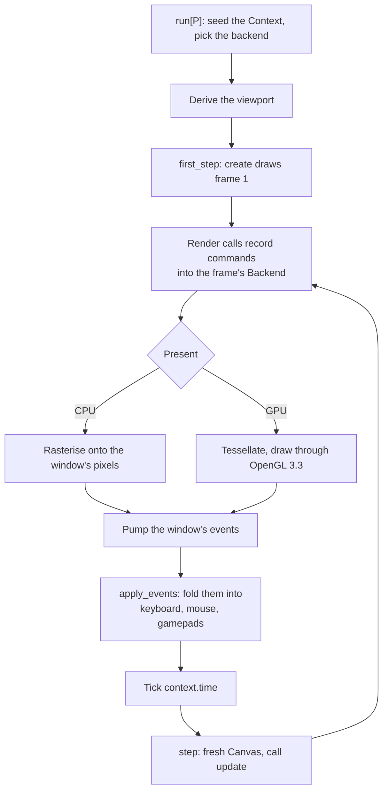
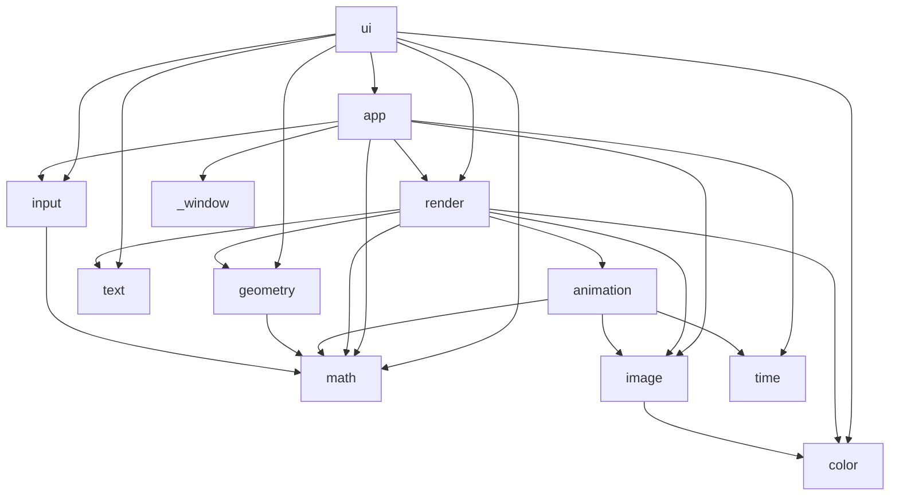

# Architecture

How Create's source is organised: which package owns what, how a frame travels through them, which
package may import which, and what makes a name public. Where a package's internals need more
explaining, a README beside its code goes into the detail; see [Package
internals](#package-internals).

## Module layout

| Module | Path | Responsibility |
|---|---|---|
| root | `src/create/__init__.mojo` | The preamble: star-imports all thirteen subpackages below |
| `app` | `src/create/app/` | `Program`, the run state (`Context`), the run loops (windowed, GPU, headless), `step`, folding events into the devices, `WindowMode`, `Cursor`, `source_path` |
| `input` | `src/create/input/` | The devices `Context` holds: `Keyboard` (keys, typed text), `Mouse`, `Gamepad`; `Key`, `MouseButton`, `GamepadButton` |
| `render` | `src/create/render/` | `Canvas` and its `with`-block guards, `Drawable` (a program's own type drawn by `canvas.draw`), how every shape and curve is drawn, `Style` (a set of style changes, layered with `over`), `Camera`, `Antialiasing`, `Autoscale`, `Align` (text anchoring), `StrokeCap`, `StrokeDash`, `StrokeAlign`, `Gradient` (with the ramp and dither both backends share), `RenderBackend` (`run`'s CPU/GPU choice; `from_arguments` reads it from a `gpu` argument), text layout, the command buffer, both backends (CPU rasteriser, GL 3.3) |
| `color` | `src/create/color/` | `Color`, `BlendMode` |
| `math` | `src/create/math/` | `Point`, `Vector`, `Transform`, `Matrix` and its functions, `Random`, `Noise`, `Easing`/`ease`, `PI`/`TAU`, util functions, re-exported `std.math` functions |
| `time` | `src/create/time/` | `Time` (the frame clock `Context` ticks), `Clock` and the run clock playheads read (`_run_clock`), `DateTime` (the wall clock) |
| `geometry` | `src/create/geometry/` | The shapes (`Rectangle`, `Circle`, `Ellipse`, `Capsule`, `Triangle`, `Sector`, `Polygon`, `Line`, `Arc`), `Bezier`, `Spline`, the `Geometry`/`Shape`/`Curve` traits, `overlaps`/`contains`/`intersects`, corner rounding's maths. Values and tests only: how a shape is drawn is `render`'s. One file per shape; `_collider.mojo` decides every test between a `Circle`, `Capsule`, `Rectangle`, `Triangle` or `Line` as a convex core grown by a radius |
| `image` | `src/create/image/` | `Image` (BMP/PNG/JPEG), `PixelBuffer` |
| `animation` | `src/create/animation/` | The playheads: `Tween`, and `Animation` (a sprite's frames) with its `Animator`. Each keeps time off the run clock |
| `text` | `src/create/text/` | `Font` (FreeType faces, glyph rasterisation), `FontWeight`, the packaged Noto faces (compiled in: `_noto.mojo`, generated from `fonts/`) |
| `audio` | `src/create/audio/` | `Sound` (WAV/OGG/FLAC/MP3), `Audio` (the device), `Playback` |
| `data` | `src/create/data/` | `Table`/`TableRow` (CSV/TSV), `JSON`, `JSONKind` |
| `ui` | `src/create/ui/` | The widgets, each a value a program updates and draws with `canvas.draw` (`Button`, `Checkbox`, `Slider`, `TextField`, `Label`, `Panel`, with `ButtonVariant`), and the traits they share (`Widget`, `Hoverable`, `Clickable`); `UI`, the tree that keeps widgets together, lays them out (`Column`, `Row`, `Space`), moves focus between them and shares the devices with other `UI`s, reached through `WidgetHandle`s; `ColorScheme` (the colours widgets are drawn in) with `StateLayers` and `FocusRing`; the theme a widget's look is resolved from, and the text editing behind `TextField` (`_TextBuffer`) |
| `_bytes` | `src/create/_bytes.mojo` | Internal leaf: little-endian integers, C strings, base64 |
| `_path` | `src/create/_path.mojo` | Internal leaf: `_caller_relative`, how every public function taking a file path resolves it against the caller's source file |
| `_optional` | `src/create/_optional.mojo` | Internal leaf: `_OptionalFloat64`, the type behind optional number keywords such as `corner_radius=8`, which takes an integer, a `Float64` or `None` |
| `_library` | `src/create/_library.mojo` | Internal leaf: `load_library`, every FFI binding's way to open a shared library (by soname, `.so.N`/`.N.dylib`, the pixi environment first) |
| `_native` | `src/create/_native.mojo` | Internal leaf: opens the compiled library, `libcreate`, and passes values to it by address; `IN_LIBRARY` (see [The compiled library](#the-compiled-library)) |
| `_window` | `src/create/app/_window/` | Internal platform layer: `Window`, `GLWindow`, typed `Event`s, SDL3 video bindings |

## How a frame runs

A program's frame passes through three packages: `app` runs the loop, `input` holds what the user
did, and `render` turns drawing into pixels.

1. **`run[P]` starts the run** (`app`). It seeds the `Context` from its arguments, and branches once
   on `backend` into the CPU loop or the GL one; `run_headless` has a loop of each kind too.
2. **Frame 1 is `create`'s.** The loop derives the viewport (the design size mapped onto the
   window), then `first_step` calls `create`, presents what it drew, and starts the clock.
3. **Every later frame**, the loop pumps the window's events (from `_window`) and folds them into
   the `Context`'s devices with `apply_events`, ticks `context.time`, then calls `step`, which
   builds a fresh `Canvas` (`context._new_canvas`) and calls `update`.
4. **A render call records, never paints** (`render`). Each `Canvas` call appends a command to the
   frame's `Backend`, carrying the style and transform as they were when the call was made.
5. **Presenting replays the frame**: on the CPU, the commands are rasterised onto the window's
   pixels; on the GPU, they are tessellated into one vertex buffer and drawn through OpenGL 3.3.
   Pixel reads and captures replay on the CPU either way, so both backends read the same pixels.

Every loop runs frame 1 through `first_step` and every later one through `step`, so the loops can
differ only in how a frame starts and where its pixels go. The details are in the
[`app`](src/create/app/README.md) and [`render`](src/create/render/README.md) READMEs.

## Layering

The packages form layers, and a package imports only from the layers below it:

| Layer | Packages | Import from `create` |
|---|---|---|
| UI | `ui` | `app`, `render`, `input`, `geometry`, `color`, `text`, `math`, `_optional` |
| Run | `app` | `render`, `input`, `image`, `math`, `time`, `_window`, `_path`, `_native` |
| Drawing | `render` | `geometry`, `color`, `image`, `animation`, `text`, `math`, `_bytes`, `_library`, `_optional`, `_path`, `_native` |
| Assets | `animation`, `image`, `text`, `audio` | `animation`: `image`, `math`, `time`, `_path`; `image`: `color`, `_bytes`, `_library`, `_path`; `text` and `audio`: `_bytes`, `_library`, `_path` |
| Values | `geometry`, `input` | `math`; `geometry` also `_optional` |
| Foundations | `math`, `color`, `time`, `data` | `math`, `color` and `time`: nothing; `data`: `_path` |
| Internal | `_window`, `_bytes`, `_library`, `_optional`, `_path`, `_native` | `_window`: `_library`; the others nothing |

The same, as a graph; every arrow points down. The leaves `_bytes`, `_library`, `_optional`, `_path`
and `_native` are left out, and so are `audio` and `data`, which import only those leaves and which
no package here imports:

The rules behind it, and what each one buys:

- **`ui`** is the top layer, and nothing imports it. It needs `app` for the `Context` a widget's
  `update` reads the input and the frame from, `render` for the canvas widgets draw on and the
  `Drawable` trait they conform to, `input` for the keys and buttons focus moves by, `geometry` and
  `math` for the widgets' rectangles and hit-testing, and `color` and `text` for their colours and
  text. An image in a `UI` is `render`'s `Picture`, so `ui` doesn't name `image`.
- **`render` never imports `app`** (it would be a cycle). `render` depends only on `math`,
  `geometry`, `color`, `image`, `animation`, `text`, `_bytes`, `_library`, `_optional` and `_path`,
  so it works without a run loop. The settings that map the design onto the window therefore reach
  `render` as plain values: in `app`, `context._set_viewport(state, …)` passes the design size and
  autoscale in, and `context._new_canvas(state^)` builds the frame's canvas. Frame-wide drawing
  settings live on `_PersistentCanvasState` itself.
- **`geometry`** depends only on `math` and `_optional`, so collision code (`overlaps`, `contains`)
  never sees `render`; `render` imports it. It holds values and their tests, and nothing about
  drawing: `render` decides how each shape and curve is drawn.
- **`color`** imports nothing from `create`; `image` and `render` both import it. It sits below
  `image` so that `Image.pixel` can return a `Color` without a `render`↔`image` cycle. `Gradient` is
  `render`'s, not `color`'s: it has points, and a transform that fits it to a shape, so it is
  drawing paint, like `StrokeDash`, rather than a colour value.
- **`data`** imports nothing from `create` but `_path`: files through the stdlib's `open()`, numbers
  through `atof`. Nothing imports it but the root.
- **`time`** imports nothing from `create`; `app` and `animation` import it. Its run clock,
  `_run_clock`, is process-wide state: once a frame, `app` copies `Context.time` into it, so a
  playhead can read the time without the clock being passed to it as an argument. It is the
  package's only shared state.
- **`animation`** holds the playheads: `Tween`, and `Animator` with the asset it plays, `Animation`.
  This mirrors `audio`, which holds `Playback` beside the `Sound` it plays. It is the only package
  that reads the run clock, so `math` and `image` stay free of time. It imports `math` for the
  easing curves and `image` for the frames.
- **`text`** depends only on `_bytes`, `_library` and `_path`. `render` uses `text` only by name, as
  it uses `image`: `Style`, `canvas.font` and text layout refer to the `Font` type, and
  `_raster.blit_glyph` takes a `_GlyphInfo` by its internal path.
- **`input`** depends only on `math`; `app` imports it. Its devices are plain state: `app`'s
  `apply_events` folds each window event in through one `_`-prefixed method per kind
  (`keyboard._key_down`, `mouse._button_down`, …), so `input` never sees an `Event` and `_window`
  stays `app`'s alone.
- **`_path`** is a leaf, imported by every package that has a public function taking a file path,
  and re-exported by nothing; `app`'s `source_path` is its public face. A public function that takes
  a path is `@always_inline`, and passes the path to `_caller_relative` directly from its own body.
  `call_location` counts exactly those two inlined calls, so the path resolves against the caller's
  file. The function then hands the absolute path to a `_`-named twin that does the work. Library
  code calls the twin (`Image._load`), never the public function: called from the library, the
  public function would resolve the path against the library's own file.
- **`_bytes`** is a leaf imported by `image`, `text`, `audio` and `render`, re-exported by nothing.
- **`_optional`** is a leaf imported by `geometry`, `render` and `ui`, re-exported by nothing. It
  holds keyword plumbing rather than maths, so it sits beside the other leaves rather than in
  `math`.
- **`_library`** is a leaf imported by every package with FFI bindings, `_window` included. A
  binding opens its library with `load_library("libname", version)`, where `version` is the soname's
  version, and never with `_DLHandle("libname.so")`. `load_library` decides the platform's file name
  and search path. It opens the versioned name because the runtime package installs that one, so the
  library is found even on a system without `-devel` packages.
- **`_window`** imports nothing from `create` but `_library`. `app` is the only package that uses
  it, and nothing re-exports it.
- **`_native`** is a leaf imported by `render` and `app`, the packages whose machinery the compiled
  library holds, and re-exported by nothing. See [The compiled library](#the-compiled-library).
- **`render` uses `image` and `animation` only by name:** only `canvas.image`'s overloads,
  `canvas.snapshot` and `Picture`, which holds the `Image` it draws, name `Image`, and
  `canvas.image(animator, …)` names `Animator`. A `render` function that needs pixels takes a
  pointer plus width/height, not an image type.

## The compiled library

A program is compiled from source, and so is every function in Create it reaches. Most of what `run`
reaches is machinery the program never names: the loops, the window, both replays, text layout and
the capture encoders. Compiled into every program, it took most of each build, about 16 of hello's
17 seconds, and the compiler's cache can't help, since an entry is per program and any edit to the
program misses it. So that machinery is compiled once, into a shared library, `libcreate`
(`src/native/libcreate.mojo`, built by `pixi run native`), and a program calls into it. What a
program does name, such as the value types and `Canvas`'s recording calls, stays source and is
inlined as before.

- **Both halves come from the same source,** so a struct has the same layout in each, and a value
  crosses as its address: `_native.address(canvas)` on the program's side, `_native.at[Canvas](…)`
  on the library's. Both allocate through the Mojo runtime's shared allocator, and `_Global`s are
  process-wide, so a value allocated on one side may be dropped on the other. The library refuses a
  program whose `Context`, `Canvas` or `Backend` has a different size, the sign of another version.
- **A call site picks its half at compile time.** The library is built with `-D
  CREATE_LIBRARY_BUILD`, so `_native.IN_LIBRARY` is true there, and a call site that reaches the
  machinery calls it directly; in a program it calls the library's entry point through
  `_native.entry`. An entry point takes addresses, and one that can fail writes the error's message
  into a `String` and returns `False`, which the program's side raises again: an error can't unwind
  through C.
- **A value the other side writes lives in a `_native.Slot`,** a heap cell, never in a plain local:
  an error message, a result, the program `run` keeps. The compiler sees an address only as an
  `Int`, so it can keep using a local's initial value after the call and miss what was written. A
  value passed only by address is kept alive past the call by hand (`_ = settings^`), since a local
  is dropped after its last use. For the same reason, `BackendHandle[]` returns a reference tied to
  the handle's origin, never an untracked one, or the handle could be dropped while the reference is
  in use.
- **What crosses:** `run` and `run_headless` hand the library a `_Driver` (`core/_driver.mojo`), the
  program's `create` and `update` as two C callbacks, and the loops call it where they called the
  program. `Canvas` keeps its `Backend` behind a `BackendHandle`, which the library builds and
  drops, and calls into it for the reads, captures, text measurement and image interning; the
  recording calls write the command buffer through `handle[]`.
- **Where it is found:** at `CREATE_LIBRARY`, which the pixi activation and the test scripts set;
  then in `$CONDA_PREFIX/lib`, where the conda package installs it; then, on macOS, as
  `@rpath/libcreate.dylib`; then by its bare name.
- **A stale library is refused.** Where the source a program was compiled from is still on disk (a
  checkout), a library older than any `.mojo` file in it would run the code from before the edit, so
  `_native` refuses it and names the file. `scripts/build_native.sh` rebuilds only when a hash of
  the source and the compiler changed, and otherwise touches the library, so a checkout that only
  changes the files' times is cleared by `pixi run native`.

A new call from source into the machinery (a canvas method that replays, say) goes through an entry
point the same way, so that a program doesn't compile the machinery behind it. The test that it
doesn't is the function count of hello's IR: `mojo build --emit llvm` and count the `define`s.

## Imports and public surface

A program writes `from create import *`. Otherwise import by name from the package that owns the
name (`from create.geometry import Circle`). Starring a single subpackage is no substitute for the
root import: a subpackage exports only the names it owns, so it leaves out the types its own
functions take.

- The root has no names of its own: it star-imports the thirteen subpackages. Never add a name
  there; add it to the owning subpackage.
- A subpackage exports only what it owns, never a lower layer's symbol. The one exception is `math`,
  which also re-exports common `std.math` functions (`sqrt`, `sin`, `cos`, `atan2`, `clamp`,
  `floor`, …) so a sketch has them without a second import, as in Processing. Mojo builtins (`abs`,
  `min`, `max`, `round`, `pow`) are already in scope and are not re-exported.
- Public surface is exactly what an `__init__.mojo` lists. A new declaration is internal unless it
  is added to one in the same change: `_module.mojo` for a wholly internal file, `_name` for an
  internal declaration in a public module. Tests reach internals by explicit path.
- A public type's field whose type is internal has a `_` name. Mojo has no private initialiser, so a
  constructor meant only for the library takes only `_`-prefixed keyword-only arguments
  (`JSON(_document=…, _index=…)`). The keywords mark it as the library's own, even though its
  signature shows an internal type.

## Package internals

Where a package's internals need explaining, its README does so:

- [`src/create/render/README.md`](src/create/render/README.md): the command buffer, both backends,
  and how each feature (gradients, curves, clips, shadows, text, …) reaches them.
- [`src/create/app/README.md`](src/create/app/README.md): the run loops, their order at startup, and
  how events, the window's settings and the clipboard flow.
- [`src/create/ui/README.md`](src/create/ui/README.md): a widget's update and look, how a `UI` lays
  out, hit-tests and draws its widgets, focus and the device claims, and how styles and state
  colours are resolved.
- [`tests/README.md`](tests/README.md): how tests are written and run, and how the GPU is covered.
