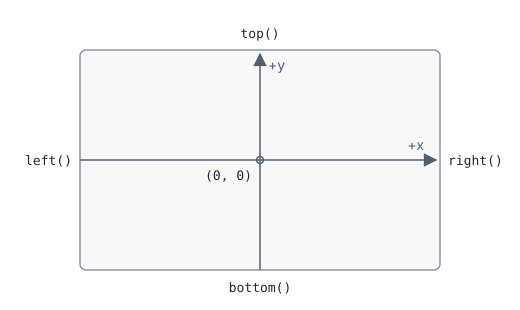

# Coordinates

Every position in Create is a pair of numbers, an x and a y, and this page explains where those
numbers land on the screen. It explains Create's coordinate system, the difference between screen,
world and local space, how the camera plays into all this, and how the size a program is written for
is fitted to a real window.

## Create's coordinate system

Unlike Processing, **Create** uses a standard Cartesian coordinate system, where the origin is
placed in the centre of the screen and y increases upwards and decreases downwards:

<p align="center">
    
</p>

So on a screen `w` units wide and `h` units high, x runs from `-w/2` at the left edge to `w/2` at
the right, and y from `-h/2` at the bottom to `h/2` at the top. A few things follow from that:
`canvas.left()` and `canvas.bottom()` are negative, something falling has a negative y velocity, and
`rotate` turns counter-clockwise. Place things against the edges with `left()`, `right()`,
`bottom()` and `top()`, rather than working them out from the width and height:

```mojo
from create import *


@fieldwise_init
struct Corners(Program):
    @staticmethod
    def create(mut context: Context, mut canvas: Canvas) raises -> Corners:
        return Corners()

    def update(mut self, mut context: Context, mut canvas: Canvas) raises:
        canvas.background(Color.WHITE)
        canvas.fill(Color.BLUE)
        canvas.circle((canvas.left() + 30, canvas.top() - 30), 20)  # top left
        canvas.circle((canvas.right() - 30, canvas.bottom() + 30), 20)  # bottom right
        canvas.rectangle((0, 0), 200, 100)  # centred on the origin


def main() raises:
    run[Corners]("Corners")
```

`canvas.width()` and `canvas.height()` are measured in units, not pixels (see [Design size and
autoscale](#design-size-and-autoscale)), and are `Float64`, since under `EXTEND` they can be
fractional. `canvas.bounds()` is the whole screen as a `Rectangle`, for `snapshot`, `clip` or
`contains`.

**Every shape is positioned by its centre**, `Rectangle.position` included, as the rectangle above
shows. Text and images still appear the right way up, even though y increases upwards; they turn,
shear and mirror only under `canvas.transform`, like everything else drawn.

## Screen, world and local space

The same numbers can mean different places, depending on which **space** they are measured in. There
are three:

- **Screen space** is the screen as described above: the origin at its centre, y increasing upwards,
  and nothing moved by a camera. `canvas.left()` to `canvas.top()`, `context.mouse.position` and
  `canvas.color_at` are all in screen space.
- **World space** is the space of a game's world, which a [camera](#the-camera) looks at. Once a
  `Camera` is set, drawing calls take world positions, and the camera decides which part of the
  world is on the screen. Without a camera, world space is the same as screen space.
  `camera.to_world(screen_point)` and `camera.to_screen(world_point)` convert between the two.
- **Local space** is the space inside a `canvas.transform` block, which the transform has moved,
  turned or scaled, so a drawing call's numbers there land somewhere else on the screen (see [The
  canvas](../drawing/canvas.md#transforms-and-guards)). `canvas.to_local(screen_point)` and
  `canvas.to_screen(local_point)` convert between local and screen space, through the transform and
  the camera together.

## The camera

A camera shows part of a larger world, and moves over it, as a film camera follows an actor. It lets
a game's world be much bigger than the screen: the level is laid out once, in world coordinates, and
the camera decides which part of it the player sees.

A `Camera` has two fields:

- **`position`** is the point of the world shown at the centre of the screen. Moving it moves the
  view: as the camera's position goes right, the world appears to slide left.
- **`zoom`** is how much the world is magnified around that point. At 1, the default, one unit of
  the world is one unit on the screen. At 2, everything appears twice as big, so only half as much
  of the world fits across the screen; at 0.5, everything appears half as big, and twice as much
  fits.

The camera is the program's own: build it in `create`, keep it as a field, and move it whenever you
like. Then, every frame, hand it to the canvas with `canvas.camera(camera)`, before drawing the
world. From that call on, every render call, and every transform block, draws through it. Like the
style, the camera is reset at the end of each frame, which is why it is set every frame rather than
once.

A camera that follows the player is the commonest kind. Setting its position to the player's each
frame works, but the view then jerks with every sudden move. Moving it a fraction of the way towards
the player each frame instead makes it trail smoothly behind: it catches up quickly when far away,
and gently as it closes in. The fraction is worked out from the time that passed, so the camera
follows at the same pace at any frame rate (see [Interpolation](../math/interpolation.md#lerp)):

```mojo
# In `create`, building the `camera` field:
var camera = Camera()  # looking at the origin, at zoom 1

# In `update`, with a `player` field that has a `position`:
var follow = 1 - exp(-5 * context.time.delta)
self.camera.position = self.camera.position.lerp(self.player.position, follow)
self.camera.zoom = clamp(  # the mouse wheel zooms in and out
    self.camera.zoom * (1 + context.mouse.wheel.y * 0.1), 0.25, 4.0
)
canvas.camera(self.camera)
# Everything drawn from here on is drawn in world coordinates.
```

Some things should stay put on the screen while the camera moves, such as the score and a health
bar. Draw them inside `with canvas.overlay():`, which suspends the camera for its block:

```mojo
# In `update`, with a `camera: Camera` field:
canvas.camera(self.camera)
canvas.image(self.player.image, self.player.position)  # world space
with canvas.overlay():
    canvas.text("Score: " + String(self.score), (0, canvas.top() - 20))  # screen space
```

`context.mouse.position` is in screen space, so to find what is under the mouse, convert it into the
space things were drawn in: `camera.to_world(context.mouse.position)` is the point in the world, and
`canvas.to_local(context.mouse.position)` the point in the current transform block, camera included
(see [Mouse](../interaction/mouse.md#what-is-under-the-pointer)).

## Design size and autoscale

Windows come in every size, but a program is written for one: the **design size**, the `width` and
`height` passed to `run` (or set later with `context.design_size(width, height)`). It is measured in
**units**, not pixels. Create scales the design to fit the actual window, so a program written for
1280 by 720 units looks the same in a small window, a large one, or full screen. How it fits a
window of a different shape is the **autoscale** mode, set with `run(..., autoscale=)`, or later
with `context.autoscale(mode)`:

| Mode | Effect |
|---|---|
| `FIT` (default) | Scales the design evenly until it fits, and centres it. Any space left over is filled with bars, as a widescreen film on an old television is (*letterboxing*). `canvas.width()` and `height()` never change |
| `EXTEND` | Scales the design the same way, but shows more of the world in the space left over instead of bars, so `canvas.width()` or `height()` grows with the window. Place things against the edges |
| `OFF` | No scaling: one unit is one of the window's pixels |

The design size and autoscale mode set from `create` take effect from the second frame, so to affect
the very first frame, pass them to `run` instead. Everything scales with the design, including font
sizes, stroke thicknesses and images: one unit is `canvas.scale()` of the window's pixels. See
[examples/window](../../../examples/window/main.mojo).
