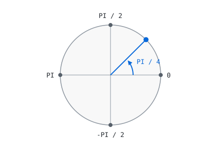

# Angles

Turning a shape, aiming a cannon, sending a spark off in a random direction, sweeping a slice of
a circle: all of these need angles. This page explains how Create measures angles, in radians,
and how to turn an angle into a direction and back with `sin`, `cos` and `atan2`. It assumes no
prior knowledge of trigonometry.

## Which way angles go

In Create, an angle is measured from the direction **straight to the right** (along the positive
x axis), and grows **counter-clockwise**:

<p align="center">
    
</p>

So an angle of 0 points right, a quarter turn points up, a half turn points left, and three
quarters of a turn points down. Rotating something by a positive angle turns it counter-clockwise,
and by a negative angle clockwise. This is the convention used throughout mathematics, and it goes
with y increasing upwards (see [Coordinates](../basics/coordinates.md)).

## Radians

Create measures angles in **radians** rather than degrees. A full turn is 2π radians, about 6.28,
where it is 360 degrees:

| Turn | Degrees | Radians | In Create |
|---|---|---|---|
| None | 0° | 0 | `0` |
| An eighth | 45° | π/4 | `PI / 4` |
| A quarter | 90° | π/2 | `PI / 2` |
| A half | 180° | π | `PI` |
| Three quarters | 270° | 3π/2 | `3 * PI / 2` |
| A whole | 360° | 2π | `TAU` |

`PI` is π, about 3.14159, and `TAU` is 2π, a whole turn. Thinking in fractions of `TAU` is often
easiest: `TAU / 4` is a quarter turn, and `TAU / 3` a third of one.

Why radians? An angle in radians is the length of the arc it sweeps on a circle of radius 1, so
the distance round a circle's edge is simply its radius times the angle. A wheel of radius 20 that
turns by 2 radians has rolled 40 units. Angles in degrees would need a conversion in every such
sum.

To work in degrees anyway, convert at the edges: `radians(90)` is `PI / 2`, for passing an angle
written in degrees to Create, and `degrees(PI)` is 180, for showing an angle to a person.

## From an angle to a direction

`cos` and `sin` turn an angle into a direction. For an angle `a`, the point `(cos(a), sin(a))`
lies on a circle of radius 1 round the origin, at that angle: `cos` gives how far right it is, and
`sin` how far up. Multiply both by a distance to go that far instead:

```mojo
# In `update`: twelve dots in a ring of radius 150.
for i in range(12):
    var angle = TAU * Float64(i) / 12
    canvas.circle((cos(angle) * 150, sin(angle) * 150), 8)
```

`Vector2D.from_angle(angle, length)` does the same and gives a vector, which is usually the more
convenient form: `Vector2D.from_angle(angle, 150)` (see [Vectors](vectors.md#angles)).

Moving the angle with the time makes something go round in a circle:

```mojo
# In `update`: a moon circling the origin once every 4 seconds.
var angle = context.time.elapsed * TAU / 4
canvas.circle(Point2D(0, 0) + Vector2D.from_angle(angle, 200), 20)
```

`sin` on its own swings smoothly between -1 and 1 as its angle grows, which makes it handy for
anything that should rise and fall, such as a bobbing or pulsing motion:

```mojo
# In `update`: a coin bobbing 10 units up and down, once a second.
var bob = sin(context.time.elapsed * TAU) * 10
canvas.image(self.coin, self.position + Vector2D(0, bob))
```

## From a direction to an angle

`atan2(y, x)` goes the other way: given a direction, it gives the angle it points at, from `-PI`
to `PI`. Note the order: `y` comes first. It is how to aim something at a target:

```mojo
# In `update`: turn a turret to face the mouse.
var to_mouse = context.mouse.position - self.turret
var angle = atan2(to_mouse.y, to_mouse.x)
with canvas.transform(translate(Vector2D(self.turret)) @ rotate(angle)):
    canvas.rectangle((30, 0), 60, 12)  # the barrel, pointing along +x before turning
```

`to_mouse.angle()` gives the same angle as `atan2(to_mouse.y, to_mouse.x)`, and reads more
easily.

## Keeping angles in range

An angle that keeps growing, such as a spinning wheel's, works fine as it is: an angle of `TAU`
points the same way as 0, and `5 * TAU` the same way again. To bring an angle back into one
turn, from 0 up to `TAU`, use `wrap(angle, TAU)` (see
[Interpolation](interpolation.md#other-helpers)).

Create also provides `tan`, and the inverse functions `asin` and `acos`, for those who need them.
